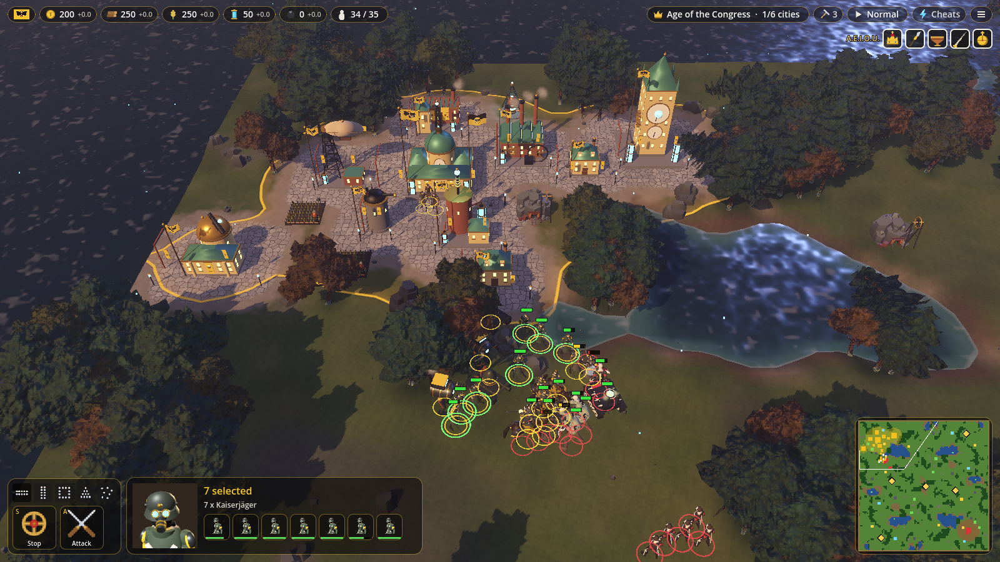

# A.E.I.O.U.

A 3D real-time strategy game where steam meets magic. The **Aetheric Monarchy**, an alternate Habsburg empire powered by Aether, alchemy and Tesla coils, fights the **Umbral Covenant**, an army of the dead, across twelve ages of history, from the Margraves to the Age of Rockets.



## Features

- **Two factions:**
  - **The Aetheric Monarchy:** grenadiers, Aether musketeers, steam tanks, airships and the Aether Colossus.
  - **The Umbral Covenant:** reavers, necromancers, bone drakes and plague engines.
- **Twelve ages**, from the Margraves to the Age of Rockets. Units upgrade with the ages (Musketeers become Riflemen, Kürassiere become armoured cars, then light tanks), buildings grow neon signs, radar dishes and glass wings, and from the 1920s the cities fill with traffic.
- **Cities and borders:** found cities, push your borders out by building, and capture enemy cities rather than razing them. Keep distant cities loyal or they revolt to Hungary.
- **Crown lands:** proclaim your cities as Croatia, Carniola, Bohemia, Galicia or Transylvania, each with its own regiment. The Covenant swears Dark Pacts instead.
- **Heroes, abilities and wonders**, and four ways to win: conquest, territory, wonders, or the five A.E.I.O.U. relics.
- **Two campaigns, twelve chapters:**
  - *Viribus Unitis* (1914–1918): the shot at Sarajevo misses, and Archduke Franz Ferdinand must hold an empire of equals together against a crown prince who was never really dead.
  - *The Undying Century* (1926–1955): the lich-magnate Szentkirályi rebuilds the dead as a company, and the Federation fights him from Houdini's séances to Franz Josef Land, the Carpathians and the Aether bomb.
- **Skirmish** against a computer opponent (Easy, Normal or Hard) on inland, coastal or island maps, and a short **tutorial**.

## Requirements

- **Godot 4.7** (the standard build; the .NET build isn't needed). The game is developed with Godot 4.7.2 on Linux. Windows and macOS should work with the matching Godot build, but are untested.
- **A graphics card with Vulkan support.** The game uses Godot's Forward+ renderer. Integrated GPUs work: pick **Medium** or **Low** under Settings → Graphics, or leave it on **Auto**.
- **No other dependencies.** All models, textures and music are in the repository.

## Getting started

1. Download Godot 4.7.2 (standard) from [godotengine.org](https://godotengine.org/download).
2. Get the code:
   ```sh
   git clone https://github.com/isvogor-foi/aeiou.git
   cd aeiou
   ```
3. Start the game. Either:
   - **From the command line:** run `godot --path .`, using the path to the Godot binary you downloaded. On Linux you can also save the binary as `tools/godot` (git ignores that folder) and run `tools/godot --path .`.
   - **From the Godot Project Manager:** choose **Import**, select `project.godot`, then press **Run** (F5).

The first launch imports all the assets, which takes a minute or two. Later starts are quick.

New to the game? Start with **Tutorial** on the title screen, then **Campaign**.

**Cheats:** start the game with `-c` (for example `godot --path . -c`) to show the Cheats menu and Ctrl+F9 in game, and to open every campaign chapter regardless of progress.

Saves and campaign progress are kept in Godot's user folder. On Linux that's `~/.local/share/aeiou/`; on Windows, `%APPDATA%\aeiou`.

## Controls

| Input | Action |
|---|---|
| Left click / drag | Select (Shift adds; double-click selects every unit of that type on screen) |
| Right click | Move, attack, gather or help build; on a building, set its rally point |
| Shift + command | Queue the order |
| Command card hotkeys | Shown on each button (e.g. `A` attack-move, `S` stop) |
| `D` / `F` | Use a unit's abilities; right-click an ability button to toggle autocast |
| Ctrl+1–9 / 1–9 | Set / recall a control group (double-tap to jump to it) |
| `.` | Cycle idle workers |
| `H` | Select your home city |
| `Space` | Centre on the selection |
| Arrows, screen edges | Scroll |
| Mouse wheel | Zoom |
| Middle-drag, `[` / `]`, Alt+Q / Alt+E | Rotate the camera a quarter turn (`Backspace` resets it) |
| `P` | Pause |
| `+` / `-` | Game speed |
| `F5` / `F9` | Quick-save / quick-load |
| `Esc` (nothing selected) or `F10` | Game menu: save, load, main menu |
| `Ctrl+F9` or ★ Cheats (top right) | Reveal the map; the Cheats menu also has infinite resources and fast building. Only when the game is started with `-c` (see below) |

## More

- [The story](docs/story.md) and [the Aetheric Monarchy](docs/aetheric_monarchy.md): setting and design notes.
- [Technical notes](docs/technical.md): tests, tools, code layout and development history.
- [Roadmap](docs/roadmap.md): Ages 7–12 and the second campaign, 1926–1955.
- [Credits](assets/CREDITS.md): all third-party art is CC0 and the music is public domain.
